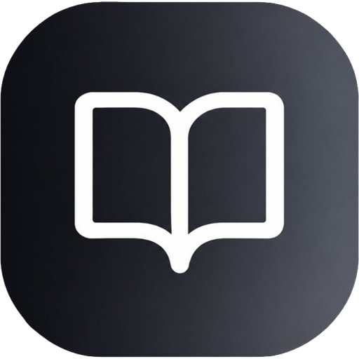

<p align="center">
  
</p>

<h1 align="center">🎓 Bahtak — بَحْثُك</h1>

<p align="center">
  <strong>المنصة الأكاديمية الأولى لإعداد وتنسيق وتوليد البحوث الجامعية الجزائرية وفق المعايير الرسمية (A4)</strong>
</p>

<p align="center">
  
  
  
  
  
</p>

---

## 📌 عن المشروع (About Bahtak)

**«بحثك» (Bahtak)** هي منصة ويب حديثة ومتكاملة موجهة لطلبة الجامعات والباحثين في الجزائر. تهدف المنصة إلى تسهيل وتسريع عملية كتابة وتنسيق وتوليد بحوث المقاييس والبحوث الأكاديمية وفق الدليل المنهجي المعتمد في الجامعات الجزائرية، مع توفير واجهة مستخدم فائقة الأناقة والسلاسة.

---

## ✨ المميزات الرئيسية (Key Features)

### 🏛️ 1. تغطية شاملة لـ 58 ولاية وشعارات الجامعات الجزائرية
- اختيار الولاية من بين **58 ولاية جزائرية**.
- إدراج الشعار الرسمي لجامعتك أو مركزك الجامعي بدقة عالية تلقائياً في الغلاف الأكاديمي.
- نماذج أغلفة معتمدة وأنيقة بألوان رسمية متناسقة.

### 🌳 2. شجرة خطة البحث التفاعلية
- هيكلة منهجية متكاملة (مقدمة، مباحث، مطالب، فروع، خاتمة، قائمة مراجع).
- إضافة وحذف ونقل العناصر بكل سهولة وسرعة.

### 📝 3. ترقيم الهوامش التلقائي أسفل صفحات A4
- ترقيم الهوامش والإحالات تلقائياً أسفل كل صفحة A4 بشكل منفصل.
- مراعاة المعايير الأكاديمية الجزائرية دون تداخل النصوص.

### ⚡ 4. توليد وتنسيق المحتوى بالذكاء الاصطناعي
- توليد خطط البحوث والمباحث وصياغة المتون الأكاديمية بنقرة واحدة.
- تلخيص وصياغة التهميش والمراجع تلقائياً.

### 🖨️ 5. طباعة فورية لـ PDF وتصدير Word (.docx)
- تصدير ملفات جاهزة للطباعة الورقية بمقاس **A4** قياسي.
- تصدير ملف Microsoft Word منسق بالكامل وقابل للتعديل.

### 🌍 6. خريطة العالم التفاعلية ثلاثية الأبعاد (3D Globe)
- استعراض تجارب وآراء طلبة وباحثي الجامعات الجزائرية.
- نافذة تقييم تفاعلية لإضافة التقييم والتعليق من 5 نجوم.

### 💾 7. حفظ تلقائي محلي واستئناف العمل
- حفظ فوري لكل خطوة ومحتوى تلقائياً على المتصفح (`Local-First`).
- زر مخصص لاستكمال العمل فور العودة للمنصة دون فقدان أي بيانات.

---

## 🛠️ التقنيات المستخدمة (Tech Stack)

- **Frontend Framework:** [React 19](https://react.dev/) + [TypeScript](https://www.typescriptlang.org/)
- **Styling:** [Tailwind CSS v4](https://tailwindcss.com/)
- **Build Tool:** [Vite 8](https://vitejs.dev/)
- **3D Interactive Visuals:** [Cobe](https://github.com/shuding/cobe) (WebGL Globe)
- **Animations:** [Framer Motion](https://www.framer.com/motion/)
- **Icons:** [Lucide React](https://lucide.dev/)

---

## 🚀 تشغيل المشروع محلياً (Run Locally)

1. **استنساخ المستودع (Clone the repo):**
   ```bash
   git clone https://github.com/ndtmk19-maker/Bahtak-.git
   cd Bahtak-
   ```

2. **تثبيت الحزم (Install dependencies):**
   ```bash
   npm install
   # أو باستخدام pnpm
   pnpm install
   ```

3. **تشغيل خادم التطوير (Start development server):**
   ```bash
   npm run dev
   ```

4. **بناء المشروع للإنتاج (Build for production):**
   ```bash
   npm run build
   ```

---

## 👨‍💻 المطور (Developer)

تم تطوير وتصميم المنصة بواسطة **[ndtmk19-maker](https://github.com/ndtmk19-maker)**.

---

<p align="center">
  صُنع بكل فخر لدعم الطلبة والباحثين في الجامعات الجزائرية 🇩🇿 💚
</p>
